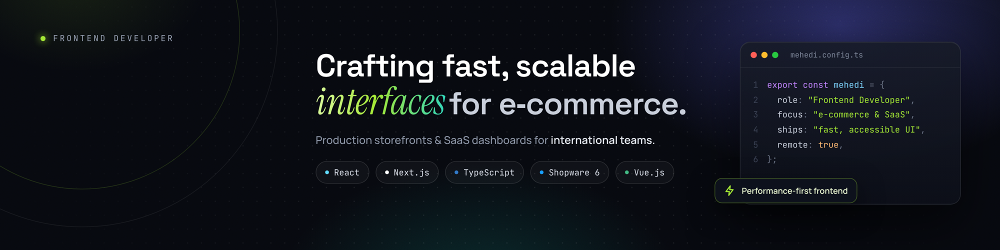

3 years of building **fast e-commerce storefronts** and **SaaS dashboards** for teams in Europe and the US. I care about what users actually feel: load time, layout stability, and interfaces that look sharp on every device. I use **Claude Code** daily to ship faster, and I review and test every line before it goes live.

  
  
  

  <picture>
    <source media="(prefers-color-scheme: dark)" srcset="https://github-readme-stats.vercel.app/api?username=mehedi1802hasan&show_icons=true&hide_border=true&bg_color=0D1117&title_color=A3E635&icon_color=A3E635&text_color=C9D1D9&ring_color=A3E635&rank_icon=github&count_private=true" />
    <source media="(prefers-color-scheme: light)" srcset="https://github-readme-stats.vercel.app/api?username=mehedi1802hasan&show_icons=true&hide_border=true&bg_color=FFFFFF&title_color=3F6212&icon_color=4D7C0F&text_color=24292F&ring_color=4D7C0F&rank_icon=github&count_private=true" />
    
  </picture>
  <picture>
    <source media="(prefers-color-scheme: dark)" srcset="https://github-readme-stats.vercel.app/api/top-langs/?username=mehedi1802hasan&layout=compact&hide_border=true&bg_color=0D1117&title_color=A3E635&text_color=C9D1D9&langs_count=8" />
    <source media="(prefers-color-scheme: light)" srcset="https://github-readme-stats.vercel.app/api/top-langs/?username=mehedi1802hasan&layout=compact&hide_border=true&bg_color=FFFFFF&title_color=3F6212&text_color=24292F&langs_count=8" />
    
  </picture>

